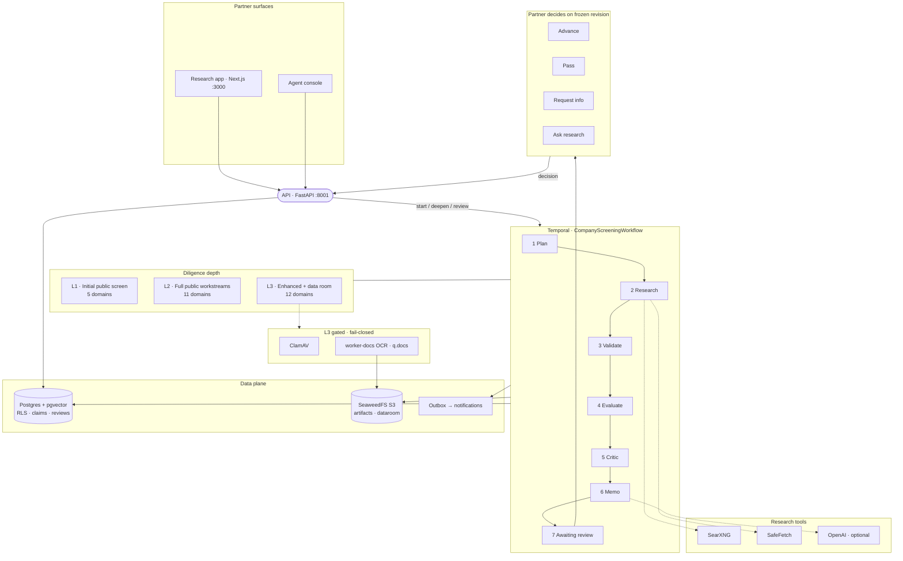

# Thesis

Open-source, self-hostable VC due diligence agent. Working UI name: **Thesis**. Licence: Apache-2.0.

Built from the hand-off package in `vc-dd-agent-handoff/` (spec, prototype, fixtures). Work proceeds in nine testable stages so each slice works before the next depends on it.

**Standing order:** continue on this codebase — do not restart. Preserve passing tests. Remediation items live in `docs/remediation-backlog.md` with P0/P1/P2 gates; baseline snapshot in `implementation-baseline.json`. P0 (D1 + tenant isolation) must be satisfied before private-document features. **Not production-ready** until remediation is independently verified.

## Product tour

Agents research a company on the public web at **Level 1 → 2 → 3**; partners decide on a frozen report version. Screenshots below are live demo runs (Notion L1, Figma L2, Candid Health L3).

<p align="center">
  
</p>

### Diligence levels

| Level 1 · Notion | Level 2 · Figma | Level 3 · Candid Health |
| :---: | :---: | :---: |
|  |  |  |
| Initial public screen · **5/5** workstreams cleared · deepen in place | Full public diligence · **5 cleared / 6 open gaps** · partner still decides | All 12 domains + data room · risks from live gates · frozen review target |

### Where the value shows up

| Cited findings (L1) | Workstream gates (L2) | Risk register (L3) |
| :---: | :---: | :---: |
|  |  |  |
| Multi-source findings partners can verify or contest | Independent-source gates (not claim-row math) | Live risks from insufficient/partial gates |

| Home queue | Partner decisions |
| :---: | :---: |
|  |  |

Regenerate screenshots + GIF after UI changes (stack must be up on `:3000`, with L1/L2 IDs in `/tmp/l1_id.txt` and `/tmp/l2_id.txt` if you want fresh companies):

```bash
npm install --no-save playwright@1.49.1
node scripts/capture_readme_media.mjs
uv pip install pillow && uv run python scripts/capture_readme_media.py
```

## Architecture

Self-hosted Compose stack: partners use the Research UI; agents run on Temporal; evidence lands in Postgres + SeaweedFS; partners decide on a frozen revision.

<p align="center">
  
</p>



**Flow in one line:** partner starts diligence → API enqueues Temporal screening → worker discovers/fetches public sources → writes claims & memo → partner decides on that revision (private docs stay ClamAV/OCR-gated).

## Stage status

| Stage | Deliverable | Status |
| --- | --- | --- |
| 1 · Contracts | ADRs, schemas, lifecycle, ledger, budgets, FIX-01 | **Tested (unit)** |
| 2 · Runnable shell | Compose, API, UI, Temporal, seed, SearXNG, auth/setup | **Running locally** |
| 3 · Durable execution | Worker `q.system`, ledger tables, budget schema | **Running locally** |
| 4 · Evidence | Claims/contradictions, SafeFetcher, corroboration, `evidence_store` snapshot/span persistence | **Implemented · local E2E** (two-firm DB isolation + FET-06 product pin still open) |
| 5 · Screening | SearXNG/heuristic discover → SafeFetch real pages → claims/corroboration; SonderMind E2E with non-`example.com` sources | **Implemented · local E2E** (OFAC fixture path + D6 ci-local fixture tested; SearXNG often degraded → site heuristics) |
| 6 · Human review | Review API, deal-team, data-room create/list scaffold, ddcalc queue | **Partial** — ClamAV/worker-docs/OCR upload still gated |
| 7 · Delivery | Outbox → notifications, optional webhook, `OutboxDispatchWorkflow` | **Implemented · local** (SMTP not shipped) |
| 8 · Hardening | RLS + `SET ROLE thesis_app`, retention dry-run `DeletionCertificate` | **Partial** — destructive object delete still gated |
| 9 · OSS release | Apache-2.0 LICENSE, NOTICE, SPDX seed + licence gate CI | **In progress** — full dep/image pin audit still open (REM-P1-06) |

**UI:** Research app shell (Home, Companies, Start assessment, Assessment tabs, Decisions, Watchlist, Thesis) and Agent console (Runs, Health, Reconciliation) now follow `docs/thesis-ui.md` tokens and IA. Still missing vs design: TanStack Query + OpenAPI codegen, full shadcn component kit, Gantt/timeline, PDF export, settings D1/D2 panels, Playwright journeys.

## Quick start

```bash
cp .env.example .env          # leave OPENAI_API_KEY empty
docker compose up --build -d
# UI:  http://localhost:3000
# API: http://localhost:8001  (mapped to container :8000; change compose if 8000 is free)
```

Contract tests (Stage 1):

```bash
uv sync
uv run pytest -q
```

Canonical contracts: `packages/contracts`. Spec: `docs/`. Seed fixtures: `fixtures/dd` (`frm_dev` → `frm_demo` at seed; errata E4). Object store default is SeaweedFS (ADR-017; confirm B1).

## Rules that stay in force

See `vc-dd-agent-handoff/README_FOR_AGENT.md`. Real integrations only (no MSW / `DEMO_MODE`). UI must load without an OpenAI key. D6 stays blocked until the fixture site is deployed.
