# Thesis

Open-source, self-hostable **VC due diligence agent**. Licence: Apache-2.0.

Agents research a company on the public web at **Level 1 → 2 → 3**; partners decide on a frozen report version. Screenshots below are live demo runs (Notion L1, Figma L2, Candid Health L3).

<p align="center">
  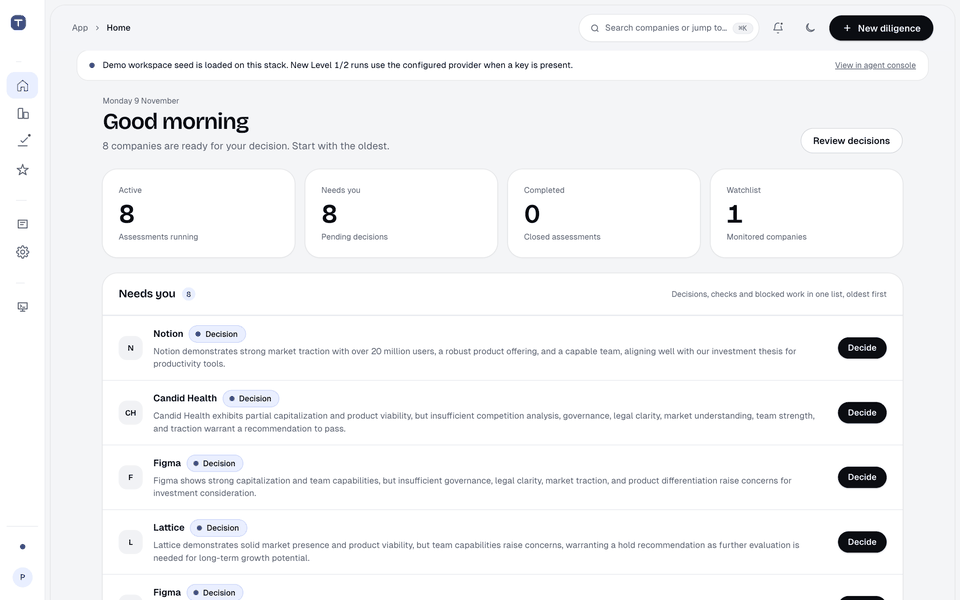
</p>

### Diligence levels

| Level 1 · Notion | Level 2 · Figma | Level 3 · Candid Health |
| :---: | :---: | :---: |
| 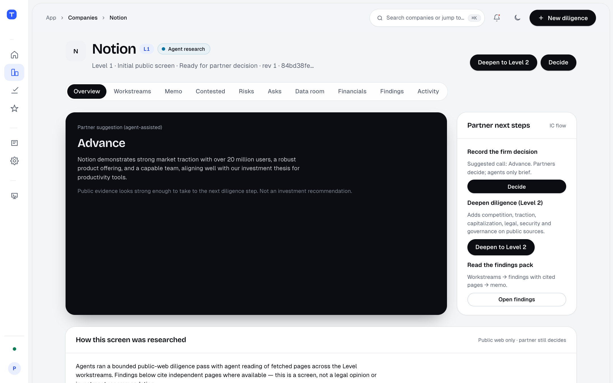 | 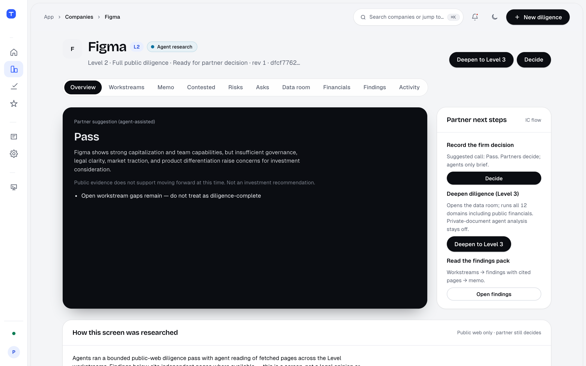 | 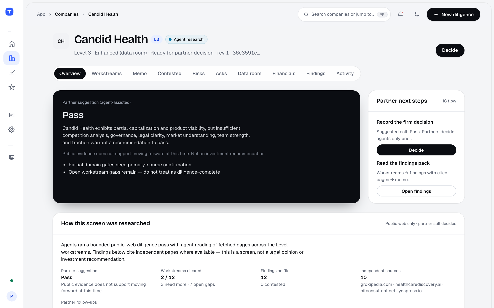 |
| Initial public screen · **5/5** workstreams cleared · deepen in place | Full public diligence · **5 cleared / 6 open gaps** · partner still decides | All 12 domains + data room · risks from live gates · frozen review target |

### Where the value shows up

| Cited findings (L1) | Workstream gates (L2) | Risk register (L3) |
| :---: | :---: | :---: |
| 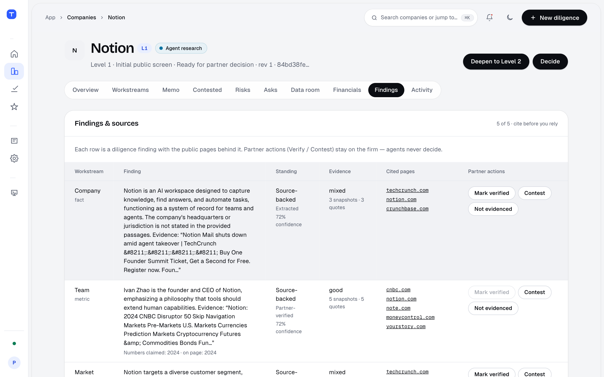 | 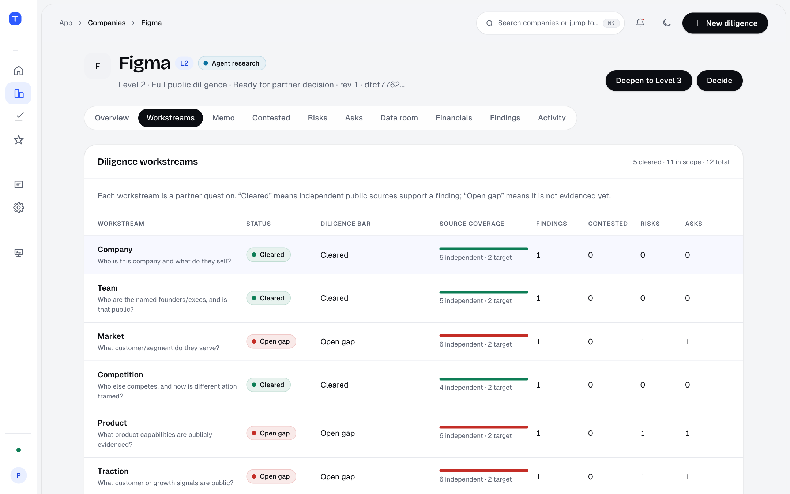 | 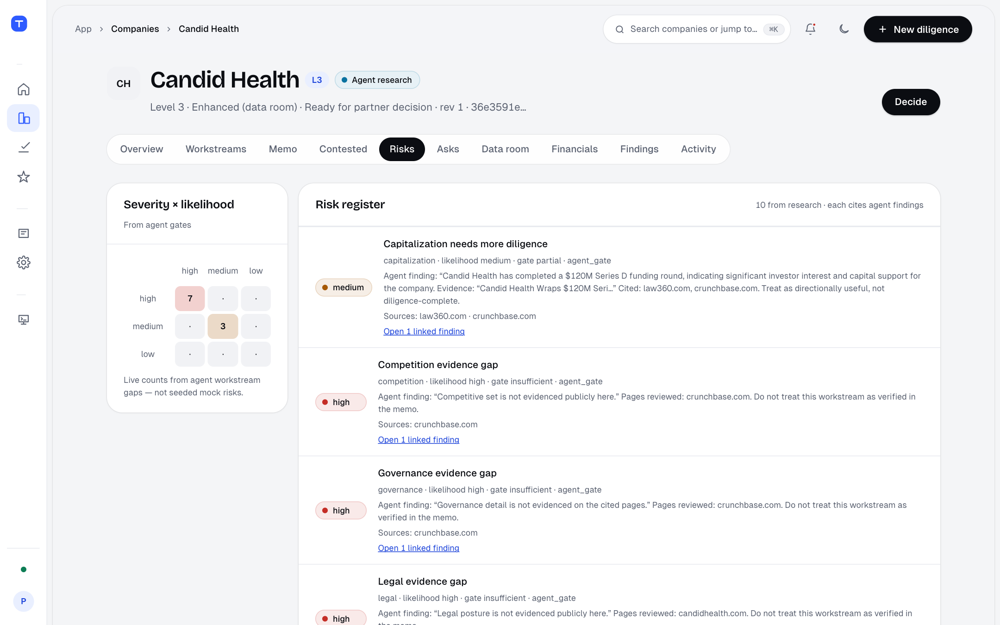 |
| Multi-source findings partners can verify or contest | Independent-source gates (not claim-row math) | Live risks from insufficient/partial gates |

| Home queue | Partner decisions |
| :---: | :---: |
| 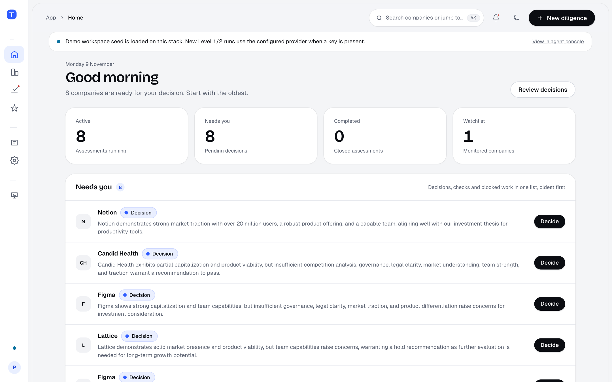 | 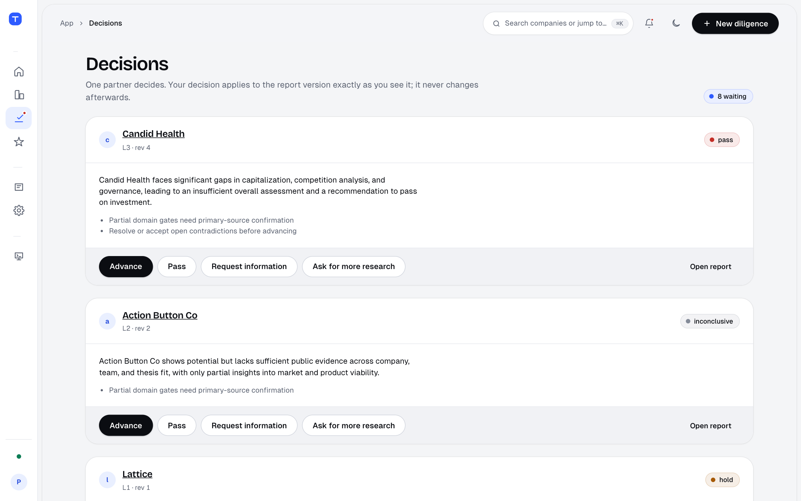 |

## Architecture

Self-hosted Compose stack: partners use the Research UI; agents run on Temporal; evidence lands in Postgres + SeaweedFS; partners decide on a frozen revision.

<p align="center">
  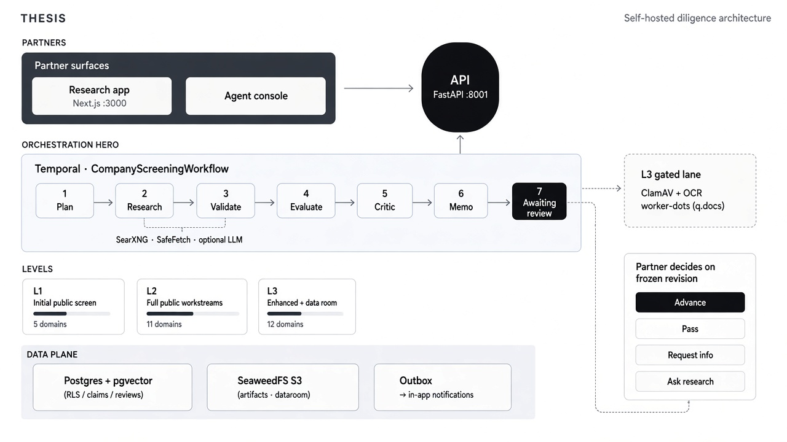
</p>

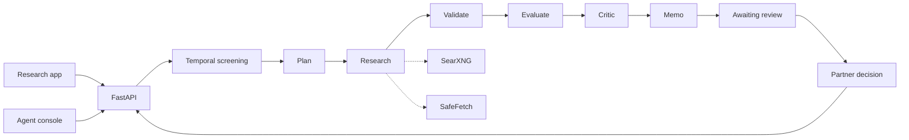

**Flow:** partner starts diligence → API enqueues Temporal screening → worker discovers/fetches public sources → writes claims & memo → partner decides on that revision (private docs stay ClamAV/OCR-gated).

## Quick start

```bash
cp .env.example .env          # leave OPENAI_API_KEY empty
docker compose up --build -d
# UI:  http://localhost:3000
# API: http://localhost:8001
```

```bash
uv sync --all-packages
uv run pytest -q
```

## Docs

| Doc | What it is |
| --- | --- |
| [`docs/domain-specification.md`](docs/domain-specification.md) | Twelve diligence domains and gates |
| [`docs/remediation-backlog.md`](docs/remediation-backlog.md) | Open P0/P1/P2 gates (not production-ready until cleared) |
| [`docs/adr/`](docs/adr/) | Architecture decisions |
| [`VERIFICATION.md`](VERIFICATION.md) | Acceptance checks |
| [`CONTRIBUTING.md`](CONTRIBUTING.md) / [`SECURITY.md`](SECURITY.md) | Contribute & report issues |
| [`packages/contracts`](packages/contracts) | Typed contracts (source of truth) |

Historical hand-off fixtures/prototypes live under `vc-dd-agent-handoff/` (see its README).

## Rules that stay in force

- Real integrations only (no MSW / fake `DEMO_MODE` network stubs)
- UI must load without an OpenAI key
- Never invent a D6 false-claims site URL
- Do not mark production-ready until Gate H / `VERIFICATION.md` passes
